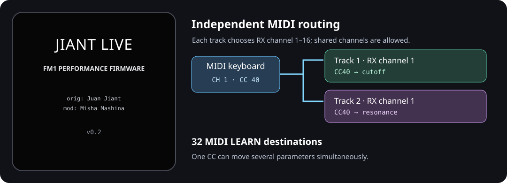

# JIANT LIVE v0.2

**Performance-focused firmware for the M-VAVE FM1**, modified by **Misha Mashina** from **JIANT by Juan Jiant** (based on Felucca).

[](LICENSE)
[](#status-and-safety)



**[Project homepage](https://github.com/MishaMashinaMM/jiant-live)** · **[Emulator](https://mishamashinamm.github.io/jiant-live/emu/)** · **[Installer (not published)](#status-and-safety)** · **[Editor (upstream)](https://juanjiant-bit.github.io/JIANT/webapp/editor/)** · **[Interactive manual (inherited)](https://juanjiant-bit.github.io/JIANT/manual/)**

The **public Jiant Live browser emulator** runs with sound and supports importing JIANT backup files. You can also run it locally. The project homepage currently links to this repository; a dedicated Jiant Live website and web installer are **not yet published**. The linked editor and interactive manual belong to **original JIANT**, have not been adapted or verified for all Jiant Live changes, and are provided as inherited references. Do **not** use the upstream web installer as a Jiant Live installer.

JIANT LIVE is designed for musicians using the FM1 as a **live multitimbral sound module**. It expands MIDI receiving and control, extends DRUM-X, and simplifies the appearance. The synthesis engines, effects, sound editing and sequencer remain available at this stage.

> **Current status:** this is a development fork, **not an official Juan Jiant release**. The full automated host suite and firmware build pass, and a real JIANT backup has been restored and checked in the browser emulator. **Jiant Live has now been successfully flashed to a physical FM1.** This confirms a successful device installation, not a complete validation of its features, persistence, MIDI behavior or long-term reliability. Back up your FM1 and prepare a recovery method before installing; no dedicated public Jiant Live web installer or hardware flashing guide is published here yet.

## What's different from JIANT

| Feature | JIANT LIVE v0.2 |
| --- | --- |
| MIDI input per track | Independent **RX channel 1–16** for each of six tracks. Two or more tracks may share a channel and sound together. |
| MIDI routing | **1-4**, **1-6** (assigned-channel routing), or **SEL** (selected-track routing). TRACKS 4/6 still determines how many tracks are active. |
| MIDI LEARN | **32 parameter destinations** rather than 10. One incoming CC can control several parameters on different tracks at once. |
| DRUM-X | **12 independent sounds** over one chromatic octave, including extra B2, S2, O2 and T2 instances with the original editing controls. |
| Display | Static **JIANT LIVE** startup splash, default JIANT presentation, larger UI retained; decorative screen animations disabled. |
| ABOUT | JIANT LIVE v0.2 identification and purpose, while retaining credits and license information. |
| Browser emulator | Can load an existing JIANT **backup JSON** into an isolated session to audition saved sounds/projects without changing the physical FM1. |
| Sequencer / sound engines | **Still present.** This fork has not removed them. |

### Six receive channels

Each track has an independently saved RX channel. The default assignments are T1=1, T2=2, T3=3, T4=4, T5=5 and T6=6.

1. On the FM1, open **GLO → MIXER** and find the **T1–T6 RX channel** controls. Choose a MIDI channel from 1 to 16 for each track.
2. In **GLO → SYSTEM**, choose **ROUTE**:
   - **1-4:** route notes to matching tracks 1–4 (within the active TRACKS setting).
   - **1-6:** route notes to matching tracks 1–6 (within the active TRACKS setting).
   - **SEL:** incoming MIDI follows the selected track, as in JIANT.
3. Use **MENU → AUDIO → TRACKS** for 4 or 6 active tracks. RX assignments for T5 and T6 are retained even when TRACKS=4.

**Example:** assign both T1 and T2 to channel 1, choose ROUTE=1-6 with TRACKS=6, and play channel 1 from a keyboard. Both tracks receive the notes. Duplicate RX channels are intentional. Switching routing, assignments or active track count releases owned notes to avoid stuck notes.

The six RX settings are **global** (not individual project or sound settings), persist across restart and survive changing projects or presets.

### MIDI LEARN: 32 destinations and shared CC

1. Open **MENU → MIDI → LEARN** and switch it **ON**.
2. Visit a track's editable parameter (for example, T1 filter cutoff) and turn its corresponding FM1 knob to select that destination.
3. Send a CC from your external MIDI controller. JIANT LIVE learns the number for that parameter.
4. To share the same CC, select another parameter (for example, T2 resonance) and send **the same CC number** again.
5. Turn LEARN **OFF** when finished. **LEARN CLEAR** removes all learned assignments.

**Example:** CC40 → T1 cutoff **and** CC40 → T2 resonance. One movement of your controller's CC40 knob changes both simultaneously.

- A single parameter can have **one learned CC** at a time. Relearning it replaces that parameter's former assignment **without removing the same CC from other destinations**.
- The **32-entry limit counts destinations**, not distinct CC numbers. A CC assigned to five parameters uses five entries.
- System-reserved CCs and CCs already handled by the standard MIDI map cannot be learned; the firmware displays **RESERVED**. When all 32 destinations are occupied, it reports **LEARN FULL**.
- Learn assignments are **global settings**, saved persistently; settings from earlier JIANT formats are migrated.
- Normal MIDI handling (notes, sustain, pitch bend and other standard controllers) continues to work. USB-MIDI and TRS-MIDI inputs are supported.

### DRUM-X: 12 editable sounds

The original eight kit sounds remain. Four additional **independent instances** are provided:

| New sound | Duplicates the original sound type | Editing |
| --- | --- | --- |
| **B2** | BD (bass drum) | Same parameters and controls as BD; independent values |
| **S2** | SD (snare) | Same parameters and controls as SD; independent values |
| **O2** | OH (open hi-hat) | Same parameters and controls as OH; independent values |
| **T2** | TM (tom) | Same parameters and controls as TM; independent values |

The kit spans **12 consecutive MIDI notes** for chromatic playing; the browser emulator offers test pads for notes **36–47**. The original sound editing pages have not been redesigned.

### Display and startup

The startup screen uses a black background with **JIANT LIVE**, **FM1 PERFORMANCE FIRMWARE**, author attribution and **v0.2**. Its text is rendered with existing firmware fonts instead of adding a large full-screen bitmap. Decorative display animations and startup LED sweep are disabled; normal informative UI and sound feedback remain. Unused skin/animation selection controls have been hidden or fixed to the Jiant Live defaults.

## Try JIANT LIVE on your computer

**[▶ Launch JIANT LIVE in your browser](https://mishamashinamm.github.io/jiant-live/emu/)** — no installation or FM1 hardware required.

The browser tab is titled **JIANT LIVE**. The page includes the virtual FM1, computer-keyboard controls, MIDI test input, and an optional JIANT backup importer. The previous upstream donation paragraph and footer navigation have been removed from this Jiant Live page. Licensing and contributor attribution remain in the repository.

The public emulator is published from the independent [`gh-pages` branch](https://github.com/MishaMashinaMM/jiant-live/tree/gh-pages), under `emu/`. Its editable HTML source is [`web/emu/index.html`](web/emu/index.html) on `main`; `gh-pages` contains the generated website files. The browser page is not the hardware installer. Changes to the source require rebuilding and republishing the emulator.

### Run the emulator locally

You can also build and serve the emulator on your own computer.

Requirements: this source checkout, the original build dependencies, Python 3, and **Emscripten** (`emcc`) for WebAssembly builds.

```sh
bash build.sh
bash web/emu/build.sh
python3 -m http.server 8000 --directory build/emu
```

Open **http://localhost:8000/** in a desktop browser and click **Switch on**. The computer keyboard and on-screen controls can play it. The page also has a **MIDI test input** panel for selecting channels 1–16 and auditioning 12 DRUM-X notes.

### Audition an existing JIANT backup

Before clicking **Switch on**:

1. Use the **Jiant backup (.json)** picker above the emulator to select a backup made with the JIANT backup tool.
2. Click **Switch on**. The file is validated and its saved objects are loaded into an **isolated browser session**.
3. Open your sounds, user banks and projects in the emulator and verify them by ear and by their parameter settings.

The original backup file and the FM1 are not changed. An imported backup is **not silently written over an existing browser flash session**. The restore path has been verified with a real JIANT v0.9.17 backup, including user banks and a project, but **this does not yet prove hardware flashing or every backup version is compatible**.

The emulator also displays upstream sample-bank choices. Those controls do **not** imply that JIANT LIVE v0.2 includes the SAMPLE synthesis engine; do not rely on that upstream feature when evaluating this fork.

## Status and safety

- **Latest host-verified development branch:** [`stage15`](https://github.com/MishaMashinaMM/jiant-live/tree/stage15) (commit `1eed930`). Its firmware code is also on [`main`](https://github.com/MishaMashinaMM/jiant-live/tree/main), which carries subsequent README-only corrections. Stage 15 passed a fresh, isolated hardware build and the complete host regression suite on 2026-11-05. Earlier immutable checkpoints, including [`stage13-verified`](https://github.com/MishaMashinaMM/jiant-live/tree/stage13-verified), remain available. **A physical FM1 has been successfully flashed with Jiant Live; broader Stage 15 hardware verification remains open.**
- **Host regression (Stage 15):** `bash tests/run_tests.sh` exited 0 (`ALL HOST TESTS PASSED`); 157 golden renders unchanged, 0 health failures, 0 voice/routing failures, 0 CPU-budget entries over limit, 0 crashes, and DRUM-X checks passed.
- **Hardware build (Stage 15):** succeeded from the exact `stage15` checkout. `build/felucca.bin` is **565,120 bytes** within a **584,336-byte** maximum (96.7% used; **19,216 bytes free**). A physical FM1 has been successfully flashed with Jiant Live, but this is **not yet a fully hardware-qualified release**.
- **Physical FM1 testing (November 2026):** Jiant Live was successfully flashed to a physical FM1, as confirmed by the project maintainer. This establishes a successful hardware flash, but does not establish full functional, persistence, MIDI, or long-duration reliability testing. Keep an external backup and recovery path; a complete public installation/recovery procedure has not yet been documented.
- **Backwards compatibility:** the browser has successfully imported one real JIANT v0.9.17 JSON backup. Compatibility of every project/settings case on hardware has **not** yet been proven.
- **No official release binary or installer is advertised here.** Do not use the upstream Juan Jiant installer links expecting them to install this fork.

For regression testing in the development environment:

```sh
bash tests/run_tests.sh
```

## Upstream documentation and references

JIANT LIVE retains the JIANT synthesizer, interface, effects, sequencer and editing workflow except for the changes described above. For the underlying instrument and its many original options, refer to the upstream manual:

- [Original JIANT project](https://github.com/juanjiant-bit/JIANT) and [original README](https://github.com/juanjiant-bit/JIANT/blob/main/README.md)
- [JIANT English manual](https://github.com/juanjiant-bit/JIANT/blob/main/docs/MANUAL.md) and [Spanish manual](https://github.com/juanjiant-bit/JIANT/blob/main/docs/MANUAL.es.md)
- [Upstream interactive manual](https://juanjiant-bit.github.io/JIANT/manual/)
- [Felucca](https://github.com/hugelton/Felucca), the firmware on which JIANT is based
- [SLOOP](https://github.com/isod89/sloop-fm1), source of JIANT's song-system lineage

**Important:** the upstream manual, navigation map, screenshots and cheat sheets describe upstream JIANT revisions; they are **not exact Jiant Live v0.2 control maps**. In particular, look here for the new RX-channel and MIDI LEARN behavior. Original illustrations retained under [`docs/`](docs/) are historical upstream assets rather than Jiant Live screenshots.

## Authors, credits and license

- **Original JIANT firmware:** Juan Ignacio Antonucci (**Juan Jiant**).
- **JIANT LIVE modification:** **Misha Mashina**.
- **Felucca firmware:** Hügelton Instruments, including Leo Kuroshita and other credited contributors.
- Additional contributors, predecessor projects, third-party tools, and font licenses retain their original attribution in source headers and accompanying license files.

**License: [GNU General Public License v3.0 only](LICENSE) (GPL-3.0-only).** This fork remains free software under the original copyleft license; modifications are identified as such. Original authors' credits and rights are preserved.

For the original author's project and support options, see [JIANT](https://github.com/juanjiant-bit/JIANT).
